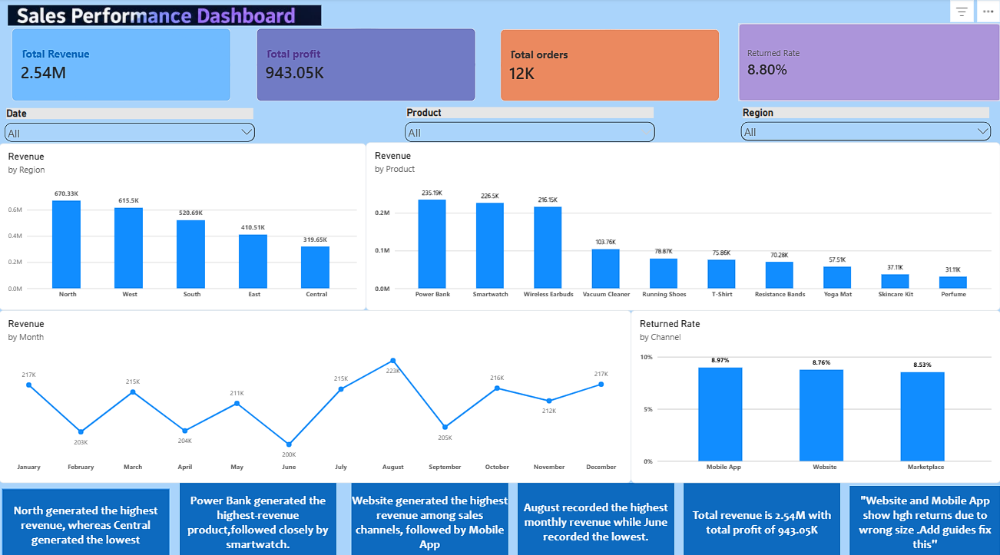

# E-commerce-Sales-Analysis

## Project overview 
A personal data analytics project focused on analysing e-commerce sales , profitability , and product returns 

## Project Objective 
To evaluate business performance using key metrics and explore sales trends across regions , product categories , and sales channels.

##Tools Used
- Power Bi
- DAX
- Microsoft Excel
- SQL
  
## Dataset Scope 
-12,018 orders

-12 months of data 

-5 regions 

-5 product categories

## Key Findings 
-Revenue : $2.54M

-Profit margin : 37.2%

-Overall return rate : 8.8%

-Mobile App return rate :8.97%

-Website return rate:8.76%

## project Report
See 'POWER BI PROJECT.PDF' in this repository.

## Data Files

- `POWER BI PROJECT.pdf` — Power BI project report.
- `dashboard.png` — Dashboard preview.
- `E-commerce_Excel_project.csv` E-Commerce data file.
- E-Commerce transaction dataset containing order, customer segment, region, sales channel, product, payment, and sales-related fields.

  ## Analysis
  The project includes a one page Power BI dashboard for analysing sales performance regional ,revenue , product revenue ,monthly trends, and return rates.

## Dashboard Preview

##Disclamer

This is a personal project. Results describe the analysed dataset and do not establish verified business impact.
